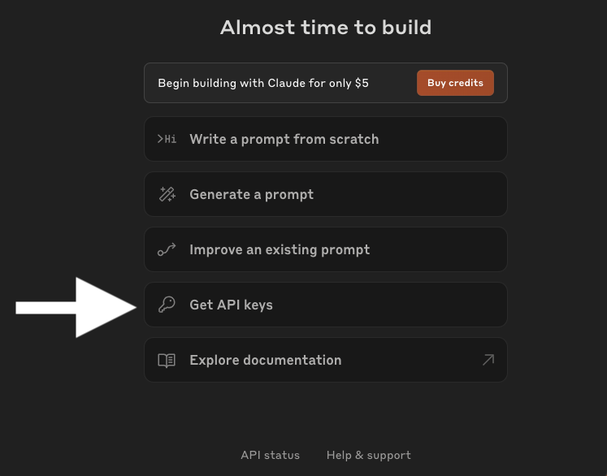
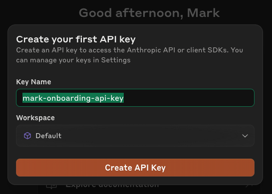
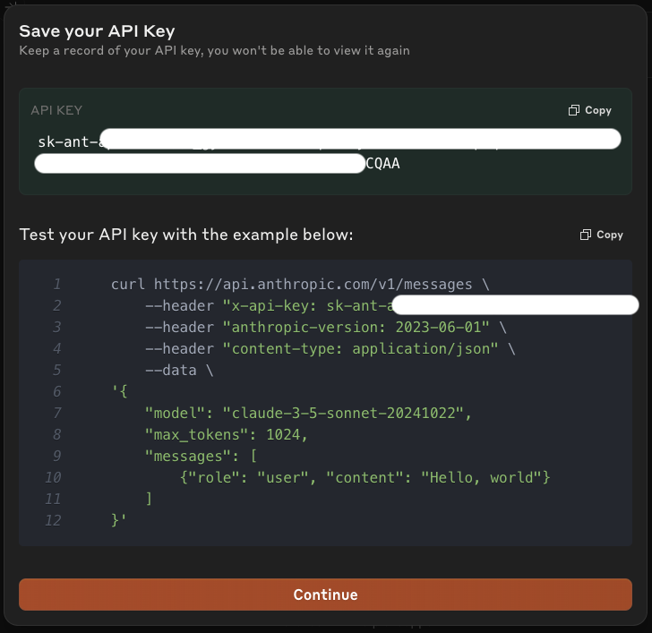
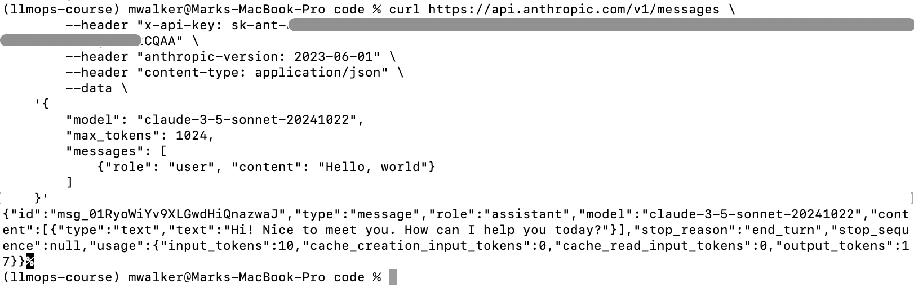

<p align = "center" draggable="false" >
</p>


## <h1 align="center" id="heading">:wave: Interactive Dev Environment (IDE) for AI Engineers </h1>

<p align="center">
  
</p>

### <h3 align="center"> Getting Started 🏗️ Building, 🚢 Shipping, and 🚀 Sharing Production LLM Applications!!

🛣️ Welcome to the beginning of your journey to become an AI Engineer! 


### 🖥️ Operating Systems Supported
* Windows
* Linux (Debian/Ubuntu)
* macOS Intel
* macOS Apple Silicon

<p></p>

## Basic Concepts and Code

We will be using a few core tools in our stack such as a `terminal`, `Command Line Interface (CLI)`, `git`, `uv`, Python, Node.js, `npm`, and Claude Code.

This setup prepares your machine for course projects such as The AI Engineer Challenge. The expected technology stack is:

- Python compatible with `>=3.12,<3.15`; the challenge currently pins Python `3.13`
- `uv` for Python version, virtual environment, and dependency management
- Git and GitHub authentication for forking, cloning, committing, and pushing
- Node.js 24 and `npm` for frontend tooling and Vercel deployment
- OpenAI or Anthropic API keys, stored in each project’s `.env` file
- [Visual Studio Code](https://github.com/microsoft/vscode) and/or [Claude Code](https://claude.com/download) from any console, as the officially supported development tools

Note: If you prefer Cursor, Codex, or another tool, then you'll be on your own in terms of debugging, but they can use the same base setup.

<details>
<summary>Terminal and Command Line Interface </summary>

We must use both terminal and a Command Line Interface (CLI) to develop AI applications with open-source tools. This is true regardless of our operating system.

A terminal is a software application like macOS Terminal, Windows Terminal, or the terminal panel inside VS Code that gives you a window where you type text-based commands and receive text-based output.

A Command Line Interface (CLI) refers to the environment or shell (e.g., Bash, Zsh, PowerShell, etc.) that interprets your text commands. The CLI is the program that actually runs commands and processes input/output; it just happens to run inside a terminal application (or emulator).

Here is a quick review of some terminal commands that you should make sure you know! It's important to understand both syntax and what they do! 

| Command                                     | Stands For            | Description                                                                                |
|---------------------------------------------|-----------------------|--------------------------------------------------------------------------------------------|
| `ls`                                        | list                  | lists all files and directories in the present working directory                           |
| `ls -a`                                     | list all              | lists hidden files as well                                                                 |
| `cd {dirname}`                              | change directory      | to change to a particular directory                                                        |
| `cd ~`                                      | change directory home | navigate to HOME directory                                                                 |
| `cd ..`                                     | change directory up   | move one level up                                                                          |
| `cat {filename}`                            | concatenate           | displays the file content                                                                  |
| `sudo`                                      | superuser do          | allows regular users to run programs with the security privileges of the superuser or root |
| `mv {filename} {newfilename}`               | move                  | renames the file to new filename                                                           |
| `clear`                                     | clear                 | clears the terminal screen                                                                 |
| `mkdir {dirname}`                           | make directory        | create new directory in present working directory or at specified path                     |
| `rm {filename}`                             | remove                | remove file with given filename                                                            |
| `touch {filename}.{ext}`                    | touch                 | create new empty file                                                                      |
| `rmdir {dirname}`                           | remove directory      | deletes a directory                                                                        |
| `ssh {username}@{ip-address} or {hostname}` | secure shell          | login into a remote Linux machine using SSH                                                |

On Windows, PowerShell understands `ls`, `cd`, `cat`, `mv`, `clear`, `mkdir`, `rm` and `ssh` too. There is no `touch` or `sudo`: create an empty file with `New-Item {filename}`.

</details>

<details>
<summary>Git</summary>

Git is a free and open source distributed version control system designed to handle everything from small to huge projects. These are the commands we will be using with `git`:

`git clone` -> clone a remote repository to your local computer

`git add` -> add files to a commit

`git commit -m {message}` -> commit changes with a message

`git push` -> push commit to remote repository
</details>

<details>
<summary>uv</summary>

`uv` is an extremely fast Python package manager and virtual environment management tool, written in Rust. `uv` aims to be a drop-in replacement for pip and pip-tools, providing significantly improved performance. We will use `uv` to manage Python itself, our package installations, and our virtual environments.

Some common `uv` commands:

`uv sync` -> Installs everything a project's `pyproject.toml` lists into the project's `.venv`. This is usually the first command you run in a course repository.

`uv run python your_script.py` -> Runs a Python script inside the project environment without requiring manual activation.

`uv init` -> Initializes a new Python project and generates a `pyproject.toml`.

`uv add <package-name>` -> Adds a package dependency to `pyproject.toml`.

Note: In most AIM repositories, the required dependencies are already defined in `pyproject.toml`, so you typically will not need to run `uv init` or `uv add` unless you are modifying or extending the project.

Optional: 

`uv venv .venv -p 3.13` -> Creates a virtual environment in `.venv` using Python 3.13.

`source .venv/bin/activate` (Mac/Linux) or `.venv\Scripts\activate` (Windows) -> Activates the virtual environment for your current terminal session. This is optional if you use `uv run`.

</details>

<p></p>

## :rocket: Let's Get Started! 

This guide installs the same tools as the one-click setup in the main [README](../README.md), but by hand, so you can see and verify each step.

Two things to know before you start:

* **Install VS Code first** ([step 1 of the README](../README.md#1-install-vs-code)) and run every command below in VS Code's terminal (**Terminal → New Terminal**).
* **Unlike the one-click setup**, which keeps its tools in `~/ai-eng` and loads them only when you ask, the installers below add themselves to your shell profile, so the tools are available in every new terminal. You don't need `~/ai-eng/env.sh`.

If a command says *not found* right after you installed it, open a new terminal. On Windows, quit VS Code completely and open it again, because VS Code only picks up changes to `PATH` when it starts.

<details>
  <summary>Windows</summary>

Make sure VS Code's terminal shows a line beginning with `PS` (PowerShell). If it shows `bash` instead, click the small arrow next to the **+** symbol at the top right of the panel and select **PowerShell**.

First, allow PowerShell to run scripts from your own computer, for your user only. `npm` and a Python project's `.venv` activation need this (the one-click setup does the same):

```powershell
Set-ExecutionPolicy -Scope CurrentUser -ExecutionPolicy RemoteSigned
```

If PowerShell says the setting is overridden by a policy, your organization manages it: ask your IT team to allow `RemoteSigned`, and use `npm.cmd` instead of `npm` until then.

| Tool                    | Purpose                                                                | Command                                                                                                                        |
|:------------------------|:-----------------------------------------------------------------------|:-------------------------------------------------------------------------------------------------------------------------------|
| :octocat: **Git**       | Version control. Claude Code also uses the Git Bash that comes with it | `winget install --id Git.Git -e` (if Windows asks for permission, click **Yes**)                                               |
| :snake: **uv**          | Python package and version manager                                     | `powershell -ExecutionPolicy ByPass -c "irm https://astral.sh/uv/install.ps1 \| iex"`                                          |
|                         | *Quit and reopen VS Code before continuing*                            |                                                                                                                                |
| :snake: **Python 3.13** | Runs Python                                                            | `uv python install 3.13`                                                                                                       |
| **Node.js 24 or newer** | Frontend tooling and `npm`                                             | `winget install --id OpenJS.NodeJS.LTS -e` (click **Yes** if asked), then quit and reopen VS Code. Check with `node --version` |
| **Claude Code**         | AI coding assistant in the terminal                                    | `irm https://claude.ai/install.ps1 \| iex`                                                                                     |
| :memo: **VS Code**      | Development environment                                                | [Download](https://code.visualstudio.com/download) (already done if you followed the README)                                   |

<details>
  <summary>Prefer Linux on Windows (WSL2)?</summary>

This is optional: the course runs natively on Windows. If you'd rather work on Linux:

1. In PowerShell, run `wsl --install`, then restart your computer when asked. This installs [WSL2](https://learn.microsoft.com/en-us/windows/wsl/install) with Ubuntu.
2. Check that Ubuntu runs on version 2 with `wsl -l -v`.
3. In VS Code, install the **WSL** extension (published by Microsoft), then open a WSL window with **Ctrl+Shift+P → WSL: Connect to WSL**.
4. In that window's terminal, follow the **Linux (Debian/Ubuntu)** steps below. Copy keys to the clipboard with `clip.exe` instead of `xclip`.

(If you find yourself getting stuck on the WSL2 installation, [here](https://www.youtube.com/watch?v=VMZH9Pj2dXw&ab_channel=StefanRows) is a link to video instructions.)

</details>

</details>

<details>
  <summary>Linux (Debian/Ubuntu)</summary>

Enter the following commands in VS Code's terminal (or a terminal opened with <kbd>Ctrl</kbd>+<kbd>Alt</kbd>+<kbd>T</kbd>).

| Tool                       | Purpose                                     | Command                                                                                                                          |
|:---------------------------|:--------------------------------------------|:---------------------------------------------------------------------------------------------------------------------------------|
| :octocat: **Git and curl** | Version control, and downloading installers | `sudo apt update && sudo apt install -y git curl`                                                                                |
| :snake: **uv**             | Python package and version manager          | `curl -LsSf https://astral.sh/uv/install.sh \| sh` <br> `source $HOME/.local/bin/env`                                            |
| :snake: **Python 3.13**    | Runs Python                                 | `uv python install 3.13`                                                                                                         |
| **nvm + Node.js 24**       | Frontend tooling and `npm`                  | `curl -o- https://raw.githubusercontent.com/nvm-sh/nvm/v0.40.8/install.sh \| bash` <br> `source ~/.bashrc` <br> `nvm install 24` |
| **Claude Code**            | AI coding assistant in the terminal         | `curl -fsSL https://claude.ai/install.sh \| bash`                                                                                |
| :memo: **VS Code**         | Development environment                     | [Download](https://code.visualstudio.com/download) the `.deb` package (already done if you followed the README)                  |

</details>

<details>
  <summary>macOS (Intel and Apple Silicon)</summary>

The steps are the same on Intel and Apple Silicon Macs. You don't need Homebrew.

**1. Git**

Check whether Git is already installed:

```bash
xcode-select -p && git --version
```

If both commands print something, skip to step 2. Otherwise, install Apple's Command Line Tools, which include Git:

```bash
xcode-select --install
```

A window opens: click **Install**, then **Agree**. It takes 5–15 minutes. Then run `git --version` to confirm.

> On a fresh Mac, `/usr/bin/git` is only a placeholder that opens this same installer, which is why we check `xcode-select -p` first.

**2. Everything else**

On a brand-new Mac, run `touch ~/.zshrc` first so the installers below have a profile to add themselves to.

| Tool                    | Purpose                             | Command                                                                                                                            |
|:------------------------|:------------------------------------|:-----------------------------------------------------------------------------------------------------------------------------------|
| :snake: **uv**          | Python package and version manager  | `curl -LsSf https://astral.sh/uv/install.sh \| sh` <br> `source $HOME/.local/bin/env`                                              |
| :snake: **Python 3.13** | Runs Python                         | `uv python install 3.13`                                                                                                           |
| **nvm + Node.js 24**    | Frontend tooling and `npm`          | `curl -o- https://raw.githubusercontent.com/nvm-sh/nvm/v0.40.8/install.sh \| bash` <br> open a new terminal, then `nvm install 24` |
| **Claude Code**         | AI coding assistant in the terminal | `curl -fsSL https://claude.ai/install.sh \| bash`                                                                                  |
| :memo: **VS Code**      | Development environment             | [Download](https://code.visualstudio.com/download), then move it into **Applications** (already done if you followed the README)   |

<details>
  <summary>Optional: Homebrew</summary>

The course doesn't need Homebrew. Install it only if you want it for other tools:

```bash
/bin/bash -c "$(curl -fsSL https://raw.githubusercontent.com/Homebrew/install/HEAD/install.sh)"
```

On Apple Silicon, follow the "Next steps" it prints to put `brew` on your PATH:

```bash
echo 'eval "$(/opt/homebrew/bin/brew shellenv)"' >> ~/.zprofile
eval "$(/opt/homebrew/bin/brew shellenv)"
```

Homebrew installs Apple's Command Line Tools itself, so if you install it first, step 1 above is already done. To update it later, run `brew update`.

</details>

</details>


<p></p>


##  Let's Make Sure That GitHub is Ready to Roll!

**Create an account with GitHub [here](https://github.com/signup) if you do not have one.**

<details>
  <summary>Tell Git who you are</summary>

Git labels every commit with a name and email. Set them once:

```bash
git config --global user.name "Ana Silva"
git config --global user.email "you@example.com"
git config --global init.defaultBranch main
```

Tip: GitHub can give you a private email for this, so your real one stays hidden. Find it at [github.com/settings/emails](https://github.com/settings/emails) (it ends in `@users.noreply.github.com`).

The last line makes new repositories start on a `main` branch, matching GitHub.

</details>

<details>
  <summary>GitHub SSH Setup</summary>
  Secure Shell Protocol (SSH) provides a secure communication channel over an unsecured network. Let's set it up!
  
  <p></p>

  1. Generate a key pair for this computer:
    
  ```console
  ssh-keygen -t ed25519 -C "your email address for github"
  ```

  2. Press **Enter** to save it in the default location (`~/.ssh/id_ed25519`).

  3. At the passphrase prompt, press **Enter** twice for no passphrase (this is what the one-click setup does), or type a passphrase if you prefer. With a passphrase, you'll be asked for it whenever Git talks to GitHub.

  4. Copy the public key that we will share with GitHub:

     * Mac: `pbcopy < ~/.ssh/id_ed25519.pub` 

     * Windows (PowerShell): `Get-Content $HOME\.ssh\id_ed25519.pub | Set-Clipboard`

     * Linux: `cat ~/.ssh/id_ed25519.pub`, then select the whole line it prints and copy it
  
  5. Open [github.com/settings/ssh/new](https://github.com/settings/ssh/new) (sign in first if asked).

  6. Give the key a title (e.g. *My laptop*), paste the key, and click **Add SSH key**.

  

  7. Test the connection:

  ```console
  ssh -T git@github.com
  ```

  The first time, SSH asks whether you trust `github.com` and shows a fingerprint. Check it against [GitHub's published fingerprints](https://docs.github.com/en/authentication/keeping-your-account-and-data-secure/githubs-ssh-key-fingerprints), then type `yes`. You should see *Hi {your username}! You've successfully authenticated*.

</details>

<details>
  <summary>Optional: a GitHub personal access token</summary>

You don't need a token to clone, commit or push: SSH covers all of that. If a later lesson asks for one, create a **fine-grained** token at [github.com/settings/personal-access-tokens](https://github.com/settings/personal-access-tokens), give it access only to the repositories and permissions that the lesson needs, and set it to expire (90 days is a good default).

Treat a token like a password: never commit it and delete it when you no longer need it.

</details>

<p> </p>


## 🧑‍💻 Let's configure our VS Code environment!

<details>
  <summary>Install the Python and Jupyter Notebook Extensions</summary>

  1. Click the `Extensions`  tab on the left side of the window.

  2. Type "Python" in the search bar.

  3. Click `Install`   on the <ins><strong>Python</strong></ins> extension (published by Microsoft)

  4. Then, type "Jupyter" in the search bar.

  5. Click `Install`   on the <ins><strong>Jupyter</strong></ins> extension (published by Microsoft)

  Or, from the terminal: `code --install-extension ms-python.python` and `code --install-extension ms-toolsai.jupyter`.

</details>

<details>
  <summary>Mac: enable the <code>code</code> command</summary>

  On Windows and Linux, the VS Code installer already sets this up. On a Mac:

  1. Open the Command Palette (<kbd>Shift</kbd>+<kbd>⌘</kbd>+<kbd>P</kbd>).

  2. Type "shell command" and click `Shell Command: Install 'code' command in PATH`.

  3. Open a new terminal. Now `code .` opens the current folder in VS Code.

</details>

<details>
  <summary>Set the Python Interpreter</summary>

  1. Open a course project folder (**File → Open Folder**).

  2. In its terminal, run `uv sync`. This creates the project's `.venv` with everything it needs.

  3. Open the Command Palette
    <strong>(Mac: </strong> <kbd>Shift</kbd>+<kbd>⌘</kbd>+<kbd>P</kbd>
    ,<strong> Windows/Linux: </strong> <kbd>Ctrl</kbd>+<kbd>Shift</kbd>+<kbd>P</kbd>)

  4. Type "Python Interpreter" and click `Python: Select Interpreter`.

  5. Select the interpreter inside the project's `.venv` folder (VS Code usually marks it *Recommended*).
  
  <p align = "center" draggable="false">
     
  </p>

  6. Now you're ready to start coding!

</details>

<p> </p>


## 🔑 Setting Up API Keys

Each course project reads its API keys from a file named `.env` in the project folder, for example:

```
OPENAI_API_KEY=sk-...
ANTHROPIC_API_KEY=sk-ant-...
```

Make sure `.env` is listed in the project's `.gitignore` so your keys are never committed to GitHub.

<details>
  <summary>Generating an OpenAI API key</summary>
     
**Create an account with OpenAI [here](https://platform.openai.com/signup) if you do not have one.**

Navigate to [OpenAI's API Developer settings](https://platform.openai.com/account/api-keys) and click on `+ Create new secret key`.


Name your key and click `Create secret key`


Copy the key and save it somewhere secure, such as a password manager. You will put it in each project's `.env` file. You won't be able to view it again, so if you lose it, you will need to generate a new one.


We recommend you run through our [OpenAI Notebook](https://colab.research.google.com/drive/16Y67VozkGVErtrF3WQArpM52AOk5pBGu?usp=sharing#scrollTo=3qCKaH6vD-jZ) to learn how to use the OpenAI API.
</details>

<details>
  <summary>Generating a Claude API key</summary>

**Create an account on the Anthropic Console [here](https://console.anthropic.com) if you do not have one.**

  Navigate to [Anthropic's Dashboard](https://console.anthropic.com/dashboard) and click on `Get API keys`
  _NOTE: If you have not purchased credits yet, it will require you to purchase at least $5.00 worth before continuing._
  

  Enter a key name (or accept the default) and click on `Create API Key`
  

  Click the `Copy` button and save the key somewhere secure, such as a password manager. You will put it in each project's `.env` file. As stated in the modal, _Keep a record of your API key; you won't be able to view it again._



  If you want to test the API key first, copy the example code and paste it into a terminal. The results will look something like this:
  

</details>

<p> </p>


## ✅ Verify Everything Works

The one-click setup script has a check mode that only looks, never changes anything, and it works for a manual installation too. Download it and run the check:

### Mac/Linux
```bash
mkdir -p ~/ai-eng && curl -fsSL https://raw.githubusercontent.com/AI-Maker-Space/Interactive-Dev-Environment-for-AI-Engineers/main/setup.sh -o ~/ai-eng/setup.sh && bash ~/ai-eng/setup.sh --check
```

### Windows
```powershell
mkdir -Force $HOME\ai-eng | Out-Null; irm https://raw.githubusercontent.com/AI-Maker-Space/Interactive-Dev-Environment-for-AI-Engineers/main/setup.ps1 -OutFile $HOME\ai-eng\setup.ps1; powershell -ExecutionPolicy Bypass -File $HOME\ai-eng\setup.ps1 -Check
```

A `[ -- ] Base folder ... not created` line is expected after a manual installation: that folder belongs to the one-click setup. Everything else should show `[ OK ]`. For any `[WARN]` or `[FAIL]` line, follow the `->` hint below it or fix that tool using the steps above.

<p> </p>


## Build Your First LLM Application

Now that you've completed your IDE set-up, head on over to the [The-AI-Engineer-Challenge](https://github.com/AI-Maker-Space/The-AI-Engineer-Challenge) repository to build your first LLM application!